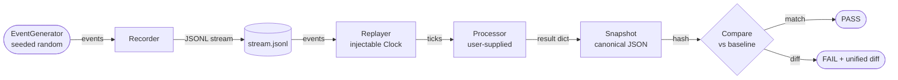

# replay-harness

[](https://github.com/your-org/replay-harness/actions/workflows/ci.yml)
[](https://codecov.io/gh/your-org/replay-harness)
[](https://www.python.org/downloads/)
[](LICENSE)

> **Deterministic record-and-replay toolkit for event streams.**

`replay-harness` lets you capture a live event stream to a JSONL file, replay it offline with an identical deterministic clock, and **prove** that a code change did not alter the output — turning "it failed in production" into a reproducible local test case, and turning "I think this refactor is safe" into a verified hash comparison.

---

## Architecture



---

## 60-Second Quickstart

```bash
# 1. Install (editable, with dev extras)
pip install -e ".[dev]"

# 2. Generate a reproducible event stream
replay generate --seed 42 --count 1000 --out stream.jsonl

# 3. Run the stream through a processor
replay run --input stream.jsonl --processor aggregates --out result.json

# 4. Bless the current result as the baseline (run once)
replay bless --actual result.json --baseline baseline.json

# 5. On every subsequent run, compare against the baseline
replay compare --baseline baseline.json --actual result.json
```

A zero exit code means the output is **bit-for-bit identical** to the baseline.

---

## Determinism Guarantees

| Source of randomness | How it's controlled |
|---|---|
| Wall-clock time | `FakeClock` with a fixed start and step — no `time.time()` in library code |
| Event ordering | JSONL is an ordered format; replay preserves insertion order |
| Random numbers | `EventGenerator` uses `random.Random(seed)` — a private, seeded instance |
| JSON serialisation | `json.dumps(..., sort_keys=True)` throughout; no `set` or `dict` iteration in results |
| Hash | SHA-256 of canonical UTF-8 JSON |

**What is NOT guaranteed:** results will differ across processors that call `random.random()` (module-level, unseeded), iterate over Python `set`s, make network calls, or read environment variables. See [`docs/design.md`](docs/design.md) for a full list.

---

## Extending: Writing Your Own Processor

A processor is any object that implements the following protocol:

```python
from typing import Any, Protocol
from replay_harness.events import Event

class ProcessorProtocol(Protocol):
    def process(self, event: Event) -> None: ...
    def result(self) -> dict[str, Any]: ...
    def reset(self) -> None: ...
```

**Example — counting events by type:**

```python
from replay_harness.events import Event
from typing import Any

class CountByTypeProcessor:
    def __init__(self) -> None:
        self._counts: dict[str, int] = {}

    def process(self, event: Event) -> None:
        self._counts[event.type] = self._counts.get(event.type, 0) + 1

    def result(self) -> dict[str, Any]:
        # Sort keys so serialisation is deterministic
        return {"counts": dict(sorted(self._counts.items()))}

    def reset(self) -> None:
        self._counts = {}
```

Pass it to `Replayer`:

```python
from replay_harness.replayer import Replayer
from replay_harness.recorder import Recorder
from pathlib import Path

events = Recorder.read_from_file(Path("stream.jsonl"))
proc = CountByTypeProcessor()
result = Replayer(strict=False).replay(events, proc)
print(result)
```

---

## Development

```bash
make install      # pip install -e ".[dev]"
make lint         # ruff check src tests
make typecheck    # mypy src
make test         # pytest tests/ -v
make docker-test  # docker build + docker run
```

Run only integration tests (no coverage gate):

```bash
pytest tests/integration/ -v --no-cov
```

Update snapshot baselines after an intentional change:

```bash
replay bless --actual result.json --baseline tests/snapshots/aggregates_seed42_n100.json
```

---

## Project Structure

```
replay-harness/
├── src/replay_harness/   # library source
│   ├── events.py         # Event dataclass + JSON serde
│   ├── clock.py          # Clock abstraction (System + Fake)
│   ├── recorder.py       # JSONL write / read
│   ├── replayer.py       # Replay engine
│   ├── processor.py      # Built-in processors (Aggregate, Anomaly)
│   ├── compare.py        # Diff + CompareResult
│   ├── generator.py      # Seeded event generator
│   ├── snapshot.py       # Canonical snapshot + hash
│   └── cli.py            # `replay` CLI entry-point
├── tests/
│   ├── unit/             # Fast unit tests
│   ├── integration/      # Determinism + snapshot regression
│   └── snapshots/        # Committed baseline JSON files
├── examples/             # Quickstart tutorial + sample stream
├── docs/design.md        # Architecture + guarantees
├── .github/workflows/    # CI
├── Dockerfile
└── Makefile
```
