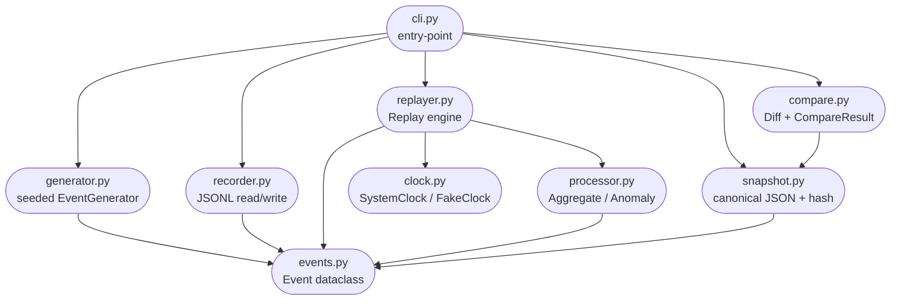

# Design: replay-harness

## Overview

`replay-harness` is a deterministic record-and-replay toolkit for Python event-stream processing. It records a sequence of events to an ordered JSONL file, replays them through a user-supplied processor using an injectable clock (so wall time is eliminated as a variable), serialises the processor's result into a canonical JSON snapshot, and computes a SHA-256 hash. Two runs with identical inputs must produce the same hash — if they do not, the processor contains non-determinism that the harness can expose and diff.

The primary use cases are: (1) capturing a production failure and reproducing it locally without live infrastructure; (2) using snapshot hashes as a regression gate — a CI step that proves a refactoring did not change observable behaviour.

---

## Module Dependency Diagram



> [!NOTE]
> `events.py` and `clock.py` are leaf modules — they import nothing from the library. All other modules may import from them but never from each other in a cycle.

---

## Determinism Guarantees

### Injectable Clock

No library code calls `time.time()` or `datetime.now()` directly. All time values come from a `Clock` instance injected at construction time. In tests and replay, a `FakeClock(start=0.0, step=1.0)` is used, producing the same sequence of timestamps on every run regardless of the host's wall clock.

### Seeded `random.Random`

`EventGenerator` holds a **private** `random.Random(seed)` instance. It never touches the module-level `random` state, so it is unaffected by other code that calls `random.seed()` or `random.random()`. Two generators created with the same seed will produce identical event sequences.

### Canonical JSON

Everywhere a dict is serialised to JSON — in `Event.to_json()`, `Snapshot.save()`, and `canonical_hash()` — the library passes `sort_keys=True`. This eliminates insertion-order differences between Python versions or dict merge operations. The resulting bytes are encoded as UTF-8 before hashing.

### Stable Ordering

Events are stored in a JSONL file, which is line-ordered. `Recorder.read_from_file()` yields events in file order. `Replayer.replay()` iterates that sequence exactly once, in order, calling `processor.process(event)` for each. The processor's `result()` method is called once after all events have been processed.

---

## What Is NOT Guaranteed

The harness cannot control sources of non-determinism that live **outside its boundary**:

| Source | Why it breaks determinism |
|---|---|
| `random.random()` / `random.choice()` at module level | Shares global state; affected by other modules |
| `set` or `frozenset` iteration | Hash-randomisation (enabled by default in CPython 3.3+) makes order unpredictable |
| `dict` iteration (Python < 3.7) | Pre-3.7 dicts are unordered; this harness requires Python 3.11+ but worth noting |
| Network calls | Latency and responses vary |
| File system timestamps / directory listing order | OS and FS dependent |
| Environment variables | Differ between machines and CI runners |
| Python version / implementation | CPython vs PyPy, or minor version changes, can alter float repr and hash seeds |
| `datetime.now()` / `time.time()` in a Processor | Bypasses the injectable clock |
| Concurrency / threading | Race conditions are inherently non-deterministic |

---

## Sequence Validation

When `Replayer` is constructed with `strict=True`, it validates that each event's `seq` field is strictly monotonically increasing (i.e., `event.seq == previous_seq + 1`). A gap or repeat raises `SequenceError`. When `strict=False`, ordering is preserved but gaps are allowed — useful for replaying partial captures.

---

## Canonical Output Format

A snapshot file (`.json`) is a plain JSON object with two top-level keys:

```json
{
  "hash": "<sha256-hex>",
  "data": { ... }
}
```

- **`hash`** — SHA-256 of `json.dumps(data, sort_keys=True).encode("utf-8")`. Computed at save time and verified at load time.
- **`data`** — the processor's `result()` dict, serialised with `sort_keys=True`.

The `compare()` function performs a **deep structural diff** of two data dicts, returning a `CompareResult` with `is_match: bool` and a list of `Diff` objects, each carrying a JSON-pointer `path`, the `expected` value, and the `actual` value. `CompareResult.format_diff()` renders a unified-style human-readable diff suitable for pytest failure messages.
